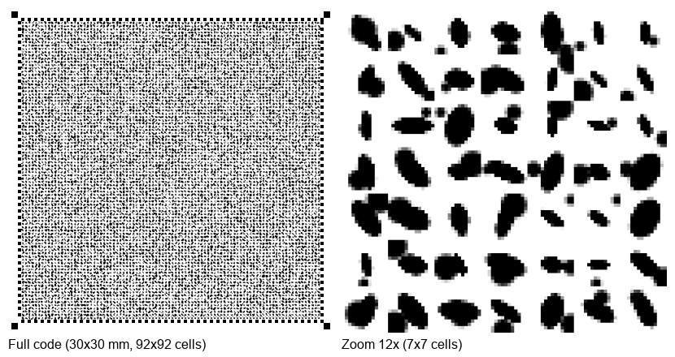

# Microform Code

**Высокоплотный 2D-код на бумаге: эллипсы + микро-точки + RS-ECC**

Замена QR-коду с **×5** ёмкостью при том же физическом размере.  
Печать на обычном принтере (1200 DPI), чтение — камера + декодер.

---

## Визуально



Слева: полный код 92×92 ячейки, 30×30 мм при 300 µm/ячейку.  
Справа: увеличенный фрагмент 7×7 ячеек — видны эллипсы и микро-точки.

Каждая ячейка содержит:
- **Эллипс**: угол (6 бит), масштаб (2 бита), вытянутость (2 бита) = 10 бит
- **Микро-точка**: сдвиг от центра (6 бит), радиус (2 бита) = 7 бит  
  (17 бит всего, 131072 различимых визуальных паттерна)

---

## Сравнение с QR

| Параметр | QR-40 | Microform (300µm) | Microform (200µm) |
|----------|-------|-------------------|--------------------|
| Размер | ~3×3 см | **3×3 см** | **3×3 см** |
| Ячеек | 177×177 | 92×92 | 150×150 |
| Бит/ячейку | 1 | **17** | **17** |
| Raw ёмкость | ~3 KB | **17.6 KB** | **46.7 KB** |
| Полезных данных | ~3 KB | **15.2 KB** | **40.7 KB** |
| Коррекция | RS | RS(255,223) | RS(255,223) |
| Допуск ошибок | ~5% | **до 5.9% ячеек** | до 5.9% ячеек |
| Печать | любая | офисный лазер 1200 DPI | офисный лазер 1200 DPI |
| **Ёмкость × QR** | **1×** | **~5×** | **~14×** |

---

## Как это работает

### Кодбук (ключевое новшество)

Из 262144 возможных комбинаций параметров эллипса и точки только **188819 (72%)**
дают уникальный визуальный паттерн при 300µm / 14px на ячейку.
Остальные 28% — дубликаты (например, при круглом эллипсе все 64 угла
выглядят одинаково).

**Решение:** кодбук из 131072 уникальных паттернов (ровно 2¹⁷).
Каждый 17-битный код → единственный паттерн → декодер читает пиксели
и делает lookup в обратной таблице. Ноль ambiguity.

### Помехоустойчивость

RS(255,223) с 32 байтами четности на блок:
- **70 блоков** × 255 байт = 17.85 KB raw
- Исправляет до **5.9%** ошибочных ячеек
- Одна ошибка в ячейке = 17 бит = ≤3 байта RS — чистая изоляция

---

## Быстрый старт

```bash
pip install -r requirements.txt

# Построить кодбук (нужен один раз, ~10 секунд)
python codebook_builder.py

# Сгенерировать код
python gen17.py --data "Hello, world!" -o hello.png

# Расшифровать
python dec17.py hello.png
```

---

## Параметры

| Флаг | По умолч. | Описание |
|------|-----------|----------|
| `--grid` | 92 | ячеек по стороне |
| `--cell-size` | 300 | размер ячейки в микронах |
| `--dpi` | 1200 | DPI вывода |
| `--data` | — | строка для кодирования |
| `-o` | mcf_17bit.png | выходной файл |

**Рекомендации по cell-size:**
- Офисная бумага 1200 DPI: **300 мкм** → 92×92 = 15.2 KB (рекомендуется)
- Офисная бумага (max): **200 мкм** → 150×150 = 40.7 KB (требует точной камеры)
- Фотобумага: **120 мкм** → 250×250 = 112 KB

---

## Структура проекта

```
codebook_builder.py  — построение кодбука (188819 уникальных паттернов)
codebook.pkl         — сохранённый кодбук (46 MB, .gitignore)
codec_17bit.py       — 17-битный кодек: RS + кодбук lookup
gen17.py             — генератор изображения
dec17.py             — декодер (маркеры → пиксели → кодбук → RS → данные)
decoder.py           — общая функция поиска маркеров

codec.py             — оригинальный 18-битный кодек (legacy)
generator.py         — оригинальный генератор (legacy)

debug_*.py           — отладочные скрипты (в .gitignore)
test_*.py            — тесты RS-коррекции
```

---

## Дорожная карта

- [x] **v1** — генератор микро-эллипсов (10 бит/ячейку)
- [x] **v2** — dual-element (эллипс + точка, 18 бит)
- [x] **v3** — **декодер: кодбук + 17-бит, 100% roundtrip**
- [ ] **v4** — внутренняя текстура штриховкой (+N бит/ячейку)
- [ ] **v5** — адаптивная плотность (auto-detect качества печати)
- [ ] **v6** — тест на реальной фотографии с телефона
