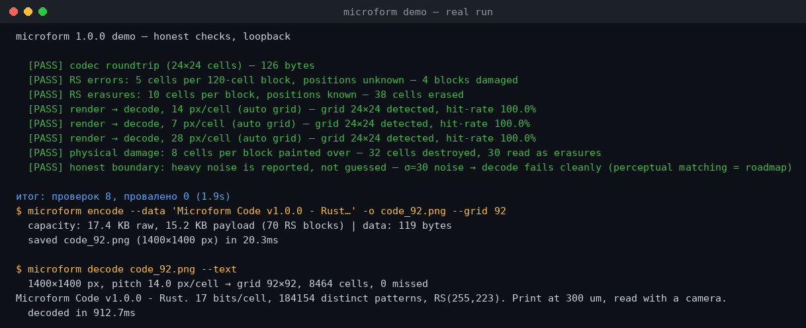
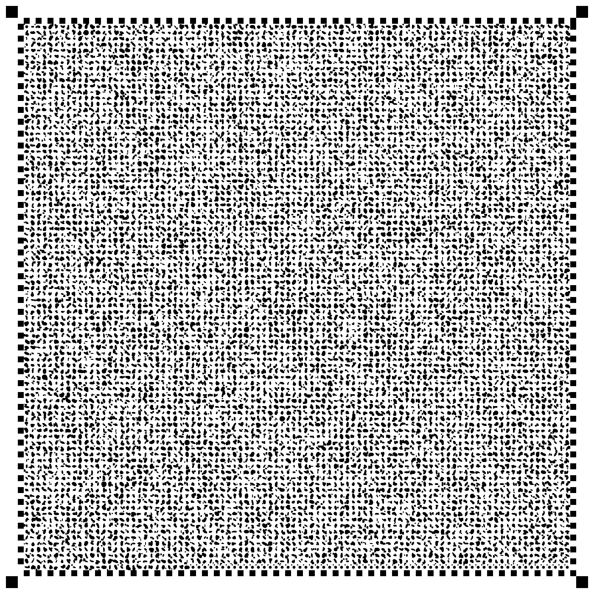
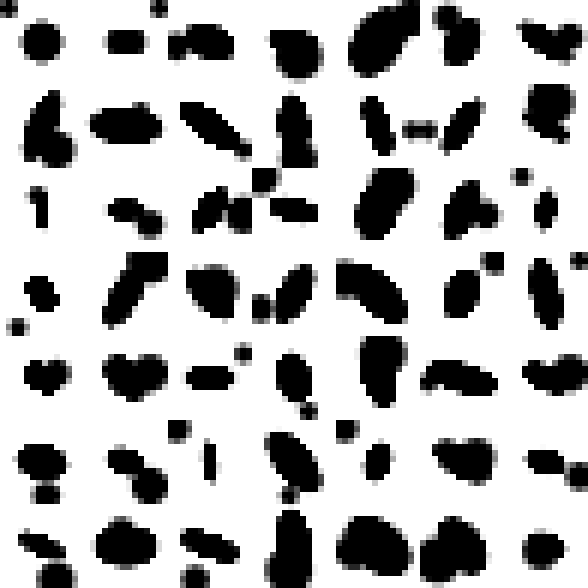

# Microform Code

### Paper is the storage medium. The printer is the write head.

**Microform Code is a dense 2D code for paper: every cell carries 17 bits as an
ellipse (angle, scale, stretch) plus an offset micro-dot, a deterministic
codebook keeps only the parameter sets that render to visually unique tiles,
and RS(255,223) protects the bitstream. At 300 µm/cell a 30×30 mm sticker
holds ~15 KB — about ×5 a QR-40 of the same size.**

[](https://github.com/kostyk348/microform-code/actions/workflows/ci.yml)
[](https://github.com/kostyk348/microform-code/releases)
[](https://github.com/kostyk348/microform-code/blob/master/LICENSE)


[**English**](README.md) · [Русский](README.ru.md)

---

## What is Microform Code?

One Rust crate (edition 2021, two dependencies: `png` and `reed-solomon` —
everything else, from Otsu thresholding to the homography solver, is written
here) that covers the whole paper-code story:

* 🧬 **17 bits per cell** — a rotated/scaled/stretched ellipse (10 bits) plus
  an offset micro-dot (7 bits); 262,144 parameter combinations, **184,154**
  render to distinct tiles at the canonical 14 px/cell, the codec uses the
  first 131,072 = 2¹⁷ of them
* 🗝️ **Deterministic codebook** — decoding is an exact pixel-tile lookup,
  no heuristics; the build is a fixed enumeration loop, identical on every
  machine, ~0.4 s in release
* 🛡️ **RS(255,223) with clean isolation** — one RS block is exactly
  255 bytes = 2040 bits = **120 cells**; a cell error spans ≤ 3 bytes, so
  **5 unknown-position errors** per block are guaranteed correctable, and
  **10 known-missing cells** (a stamp, a smudge) are recovered as erasures
* 📐 **Scale-aware decoding** — the pitch is measured from the corner
  markers; each scale gets its own codebook of tiles that stay unique at
  that scale, and the cell bit depth adapts (17 → 15 → 12 bits, always a
  divisor of a 2040-bit block)
* 🖨️ **Print-friendly** — pure black-and-white raster, grid auto-detected,
  no quiet-zone gymnastics beyond 1 cell of padding

## Demo (real output, loopback)

```text
$ microform demo

  [PASS] codec roundtrip (24×24 cells) — 126 bytes
  [PASS] RS errors: 5 cells per 120-cell block, positions unknown — 4 blocks damaged
  [PASS] RS erasures: 10 cells per block, positions known — 38 cells erased
  [PASS] render → decode, 14 px/cell (auto grid) — grid 24×24 detected, hit-rate 100.0%
  [PASS] render → decode, 7 px/cell (auto grid) — grid 24×24 detected, hit-rate 100.0%
  [PASS] render → decode, 28 px/cell (auto grid) — grid 24×24 detected, hit-rate 100.0%
  [PASS] physical damage: 8 cells per block painted over — 32 cells destroyed, 30 read as erasures
  [PASS] honest boundary: heavy noise is reported, not guessed

итог: проверок 8, провалено 0 (1.9s)
```



| The 92×92 code (~15 KB) | 7×7 cells, zoomed ×6 |
| --- | --- |
|  |  |

## Comparison with QR

| Parameter | QR-40 | Microform (300 µm) | Microform (200 µm) |
| --- | --- | --- | --- |
| Physical size | ~30×30 mm | **30×30 mm** | **31.6×31.6 mm** |
| Grid | 177×177 modules | 92×92 cells | 150×150 cells |
| Bits per module | 1 | **17** | 15 |
| Raw capacity | ~3 KB | 17.4 KB | 41.1 KB |
| Payload | ~3 KB | **15.2 KB** | **35.9 KB** |
| ECC | RS | RS(255,223), 70 blocks | RS(255,223), 161 blocks |
| Guaranteed cell recovery | — | 5 errors or 10 erasures / 120 cells | 8 errors or 13 erasures / 136 cells |
| Printing | any | office laser, 1200 dpi | office laser, max |
| **Capacity vs QR** | **1×** | **~5×** | **~12×** |

## Quick start

```bash
cargo install --path .          # or: cargo build --release

microform encode --data "Hello, paper!" -o hello.png
microform decode hello.png --text
microform capacity              # the three print presets
microform demo                  # 8 honest checks, ~2 s
```

As a library:

```rust
use microform::{generate, pngio, decode_png, RenderSpec};

let img = generate(RenderSpec::default(), b"Hello, paper!");
pngio::write_gray("hello.png".as_ref(), &img).unwrap();
assert_eq!(decode_png("hello.png".as_ref(), None).unwrap().data, b"Hello, paper!");
```

## How it works

1. **Framing** — user data gets a 4-byte length prefix, fills whole
   RS(255,223) blocks, and the leftover capacity is deterministic PRNG
   noise so the code looks like a uniform texture (no blank gulfs).
2. **Cells** — each 17-bit value (or the scale-adapted depth) selects one
   canonical tile from the codebook; tiles are rendered at the print scale.
3. **Frame** — four 2×2-cell corner markers, a 1-cell checkerboard border
   (the calibration ruler the decoder uses to measure the pitch).
4. **Decoding** — Otsu → erosion → connected components find the markers;
   a 4-point homography maps the cell grid onto the image; every cell is
   resampled to its tile and looked up; unknown tiles become RS *erasures*
   (their byte positions are known!), which doubles the recovery budget.

## The honest parts

* **Exact lookup is brittle.** A pristine raster decodes perfectly at any
  supported scale; *noise, blur or a photograph break the tile hash*. The
  demo shows the boundary deliberately: heavy noise is **reported**, not
  guessed. Camera decoding needs perceptual matching — it is the roadmap,
  not a claim. See [LIMITATIONS.md](LIMITATIONS.md).
* **Scale is a format parameter.** A code printed at 7 px/cell and one
  printed at 14 px/cell use different (deterministically derived) code
  tables; the decoder detects the scale from the image itself.
* The Python prototype that started this repo lives in the git history;
  the Rust crate is the reference implementation since v1.0.0.

## Project layout

```
src/layout.rs      — geometry, parameter space, value↔params packing
src/patterns.rs    — ellipse/dot masks, canonical tile rendering
src/codebook.rs    — deterministic build, 17-bit selection, scale books
src/codec.rs       — RS framing, PRNG padding, erasure-aware decoding
src/render.rs      — canvas: markers, checkerboard border, data cells
src/imgproc.rs     — Otsu, erosion, connected components, blur, noise
src/homography.rs  — exact 4-point DLT solver
src/locate.rs      — marker search, pitch and grid-size estimation
src/decode.rs      — scale-independent decode pipeline
src/demo.rs        — the 8 honest checks
src/main.rs        — hand-rolled CLI (encode/decode/capacity/codebook/demo)
tests/             — codebook, codec, roundtrip, CLI integration (24 tests)
```

## License

Apache-2.0 — see [LICENSE](LICENSE).
