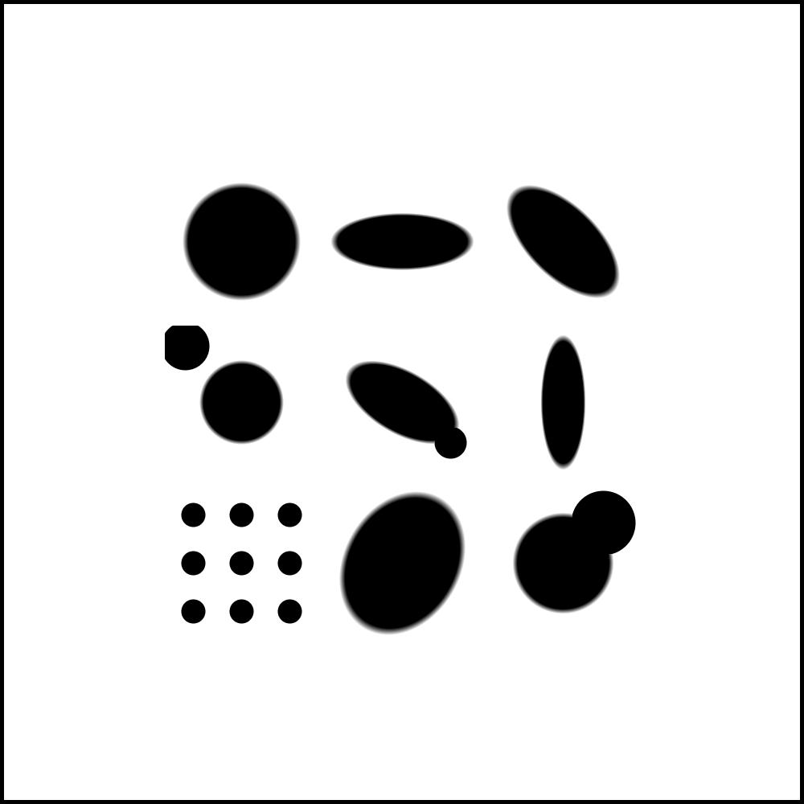
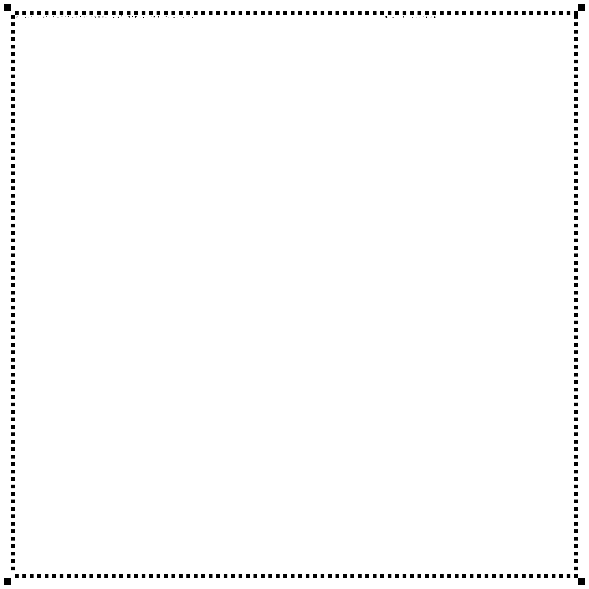

# Microform Code

**Высокоплотный 2D-код на бумаге: эллипсы + микро-точки + RS-ECC**

Замена QR-коду с **×10-100** ёмкостью при том же физическом размере.  
Печать на обычном принтере, чтение камерой телефона.

---

## Визуально

| Разные микро-формы (демо) | Полный код (3.16×3.16 см, 150×150 ячеек) |
|:---:|:---:|
|  |  |

**Типы элементов в каждой ячейке:** круг, эллипс под углом, вытянутый эллипс,
комбинация эллипс + микро-точка, сетка точек и т.д.  
Каждый элемент кодирует часть данных.

---

## Сравнение с QR

| Параметр | QR-40 | Microform v2 (офисная) | Microform v2 (фото) |
|----------|-------|----------------------|---------------------|
| Размер | ~3×3 см | **3×3 см** | **3×3 см** |
| Ёмкость (данных) | ~3 KB | **~43 KB** | **~170 KB** |
| Ячеек | 177×177 | 150×150 | 250×250 |
| Бит/ячейку | 1 | **18** | **18** |
| Коррекция ошибок | RS | **RS(255,223)** | RS(255,223) |
| Печать | любая | офисный лазер/струй | фотобумага |
| Цвет | Ч/Б | Ч/Б | Ч/Б |
| **× к QR** | **1×** | **~14×** | **~57×** |

---

## Как это работает

Каждая ячейка кодирует **18 бит** через два визуальных элемента:

```
┌─────────┐
│         │
│  ◯  +•  │  Главный эллипс:
│         │    угол (6 бит) + размер (2) + вытянутость (2) = 10 бит
│         │
│         │  Микро-точка:
│         │    позиция (6 бит) + радиус (2) = 8 бит
└─────────┘
```

- Главный эллипс даёт базовую ёмкость через геометрию
- Микро-точка добавляет второй слой в той же площади
- Данные защищены Reed-Solomon ECC (исправляет ошибки сканирования)
- Калибровочная рамка позволяет校正 перспективу и контраст

---

## Быстрый старт

```bash
# Клонировать
git clone https://github.com/kostyk348/microform-code.git
cd microform-code
pip install -r requirements.txt

# Демо-картинка
python generator.py --demo -o demo.png

# Свои данные
python generator.py --data "Hello, world!" -o hello.png

# Максимальная плотность (офисная бумага)
python generator.py --grid 150 --dpi 1200 -o dense.png

# Максимальная плотность (фотобумага)
python generator.py --grid 250 --cell-size 120 --dpi 1200 -o photocode.png
```

---

## Параметры генератора

| Флаг | По умолч. | Описание |
|------|-----------|----------|
| `--grid` | 150 | ячеек по стороне |
| `--cell-size` | 200 | размер ячейки в микронах |
| `--dpi` | 1200 | DPI вывода |
| `--data` | — | строка для кодирования |
| `-o` | microform_code.png | выходной файл |
| `--demo` | — | режим демо-картинки |

**Рекомендации по cell-size:**
- Офисная бумага (80 г/м²): **200 мкм** → 150×150 = 43 KB
- Фотобумага матовая: **120 мкм** → 250×250 = 170 KB
- Фотобумага глянец: **80 мкм** → 375×375 = 380 KB

---

## Структура проекта

```
codec.py       — кодирование: данные → RS-ECC → биты → ячейки
generator.py   — рендеринг: биты → паттерн для печати
decoder.py     — (TODO) фото → биты → RS-ECC → данные
tests/         — (TODO) тестовые печати, замеры
```

---

## Дорожная карта

- [x] **v1** — генератор микро-эллипсов (10 бит/ячейку)
- [x] **v2** — dual-element + RS-ECC (18 бит/ячейку)
- [ ] **v3** — декодер: фото → параметры → данные
- [ ] **v4** — внутренняя текстура штриховкой (+5 бит/ячейку)
- [ ] **v5** — адаптивная плотность (auto-detect качества печати)
